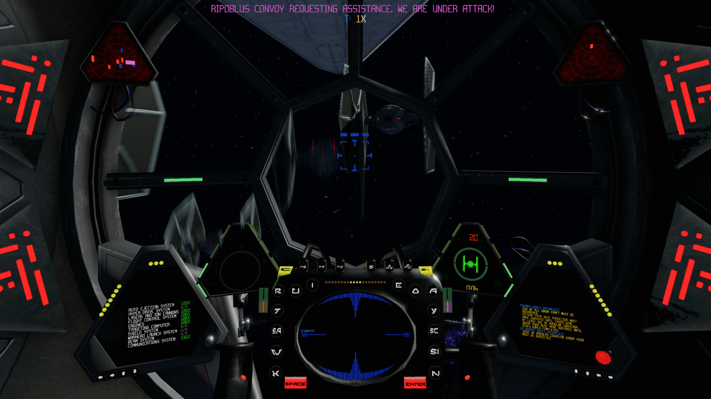
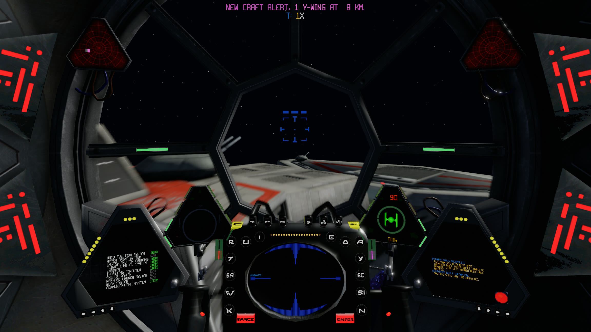
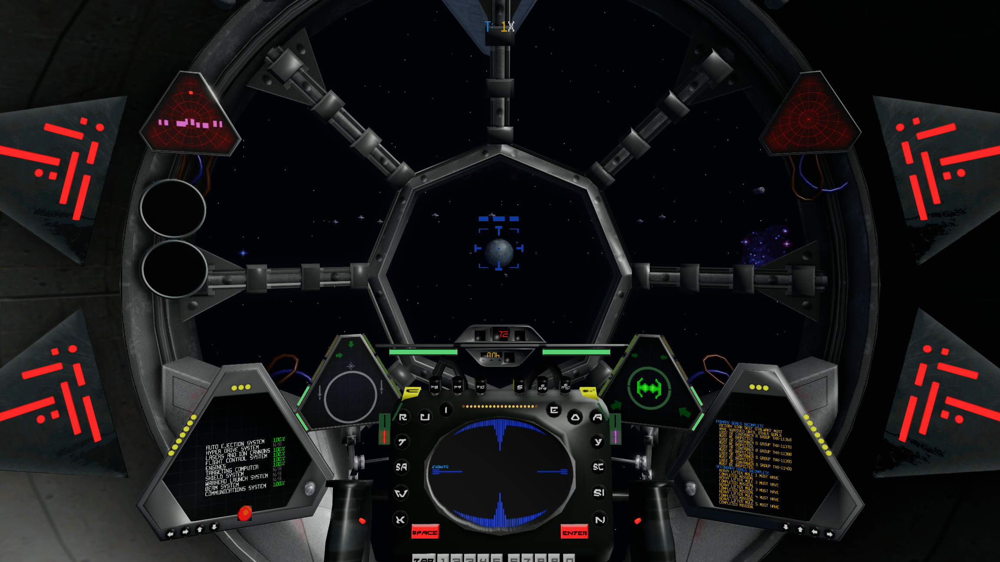

# OpenTIE

*TIE Fighter Total Conversion's ship models and cockpits (not included with OpenTIE) in flight, with the HUD on
each cockpit's own screens as its Dynamic Cockpit file lays it out.*

OpenTIE is an open-source reimplementation of *Star Wars: TIE Fighter* for
Windows, macOS, and Linux. It runs the original game data natively on current
systems, combining the 1995 Collector's CD-ROM menus, cutscenes, and adaptive
iMUSE soundtrack with the 1998 Windows release's flight simulation and 3D
assets.

> [!IMPORTANT]
> OpenTIE does not include any content from the original game. A complete
> installation of both the 1995 Collector's CD-ROM and the 1998 Windows release
> is required.
>
> *Star Wars: TIE Fighter Special Edition* is available from
> [GOG](https://www.gog.com/en/game/star_wars_tie_fighter_special_edition) and
> [Steam](https://store.steampowered.com/app/355250/STAR_WARS_TIE_Fighter_Special_Edition/).

## The best of both editions

The 1995 and 1998 releases each have their own presentation, flight simulation,
and soundtrack. OpenTIE always combines:

- the 1995 menus and cutscenes
- the 1998 flight simulation and 3D assets
- the adaptive 1995 iMUSE soundtrack

This retains the 1998 flight presentation without giving up the interactive
music of the Collector's CD-ROM. The menu, cutscene, and flight engine
selections are fixed and cannot be switched in the settings.

## Adaptive music

OpenTIE reimplements the adaptive iMUSE soundtrack from the 1995 Collector's
CD-ROM. The music responds to mission events and moves seamlessly between
themes during flight.

OpenTIE can emulate Roland SC-55 Sound Canvas, the hardware for which the game’s
music was originally composed. This requires compatible SC-55 ROMs supplied by
the user.

Built-in Sound Blaster-compatible OPL3 emulation is available for the classic
FM-synth sound, while FluidSynth can play the soundtrack with a user-selected
SoundFont.

The original prerecorded TIE98 music remains available when the complete 1998
experience is preferred.

The **TFTC** music source plays the digital soundtrack of TIE Fighter Total Conversion, as FLAC recordings in
`resources/tftc/`. In flight, TIE's own adaptive music logic picks the state, and each of its 11 states plays its
recording, `NN. Inflight - <Name>.flac` in `music/` (Introduction, Wait, Rebels, Polar Plotting, Intrusion,
Challenge, Confidence, Panic, Climax, Fail, Success). Moving between states plays the recorded bridge the MIDI
script would play there, and every music sequence (kills, losses, goals, arrivals, eject, hyperspace) plays its
recorded sting over the music, all from `signals/`. In the front end, TIE's menu music script picks the piece and
its recording plays from `rooms/` (Register, Main Concourse, Tech Room, Bridge) or `songs/`. Silence at the start
and end of each recording is trimmed as it plays.

The recordings come from [this soundtrack](https://drive.google.com/drive/folders/12mgIewG2_mqL5EVr1gLzrLE4mhYJKePp).
Download it and place its files in the matching `resources/tftc/` folders (`music/`, `signals/`, `rooms/`, `songs/`),
keeping their file names.

## Graphics

OpenTIE renders flight with a modern graphics pipeline that combines the
original models and cockpit artwork with high-resolution rendering and
substantially more advanced lighting.

Modern graphics include:

- shadows, ambient occlusion, and bloom
- motion blur
- MSAA and AMD FidelityFX FSR 3.1.4 anti-aliasing and upscaling
- HDR output

Two flight display options are available under **Settings > Video > Display**:

- **TFTC Cockpits** renders flight at 16:9 and replaces the cockpit artwork with a
  3D cockpit model. It is off by default.
- **Centered Messages** shows flight messages in the middle of the screen and
  removes the bottom message bar. It is on by default.

The classic (original renderer) view is disabled; `TAB` no longer switches to it.

### TFTC cockpit models

OpenTIE does not ship the cockpit models. With TFTC Cockpits on, it loads XWA-format cockpit OPTs from
`resources/cockpit3d/` next to `OpenTIE.exe`, named `TieFighterCockpit.opt`, `TieInterceptorCockpit.opt`,
`TieBomberCockpit.opt`, `TieAdvancedX1Cockpit.opt`, `TieDefenderCockpit.opt`, `AssaultGunboatCockpit.opt` and
`MissileBoatCockpit.opt`. `tools/tftc/copy_tftc_models.sh <TFTC dir>` copies them there from a TFTC install,
with each cockpit's `Materials` `.mat` file, whose metallic, glossiness and shadeless values the cockpit is drawn
with, and its `DynamicCockpit` `.dc` file. A craft without a model keeps the cockpit artwork. The models are drawn only with the
HD flight models, and the first flight with each one takes several seconds to load.

With a TFTC cockpit the HUD gains two panels: **Objectives**, the mission goals screen's text, and **Repairs**,
the damage-control readout.

### Cockpit displays

A TFTC cockpit shows the HUD on its own screens, laid out by the cockpit's `.dc` file the way X-Wing Alliance
Upgrade's Dynamic Cockpit does it, following OpenXWA's reading of those files. Each `.dc` section names a texture
of the cockpit and the rectangle of it that shows a display; OpenTIE finds that rectangle on the model and draws the
matching TIE instruments into it:

| `.dc` source | TIE instruments |
|---|---|
| `TARGETING_COMPUTER_SRC` | Targeting computer, with the target view and readouts |
| `LEFT_SENSOR_SRC` / `RIGHT_SENSOR_SRC` | Front / rear radar |
| `SHIELDS_SRC` | Shields and hull |
| `DUAL_LASERS_L_SRC` | Laser charge |
| `MISSILES_SRC`, `AUTOSIZE_MISSILES_L_SRC` | Warheads |
| `SPEED_THROTTLE_SRC`, `AUTOSIZE_SPEED_SRC` | Speed and throttle |
| `BEAM_LEVEL_SRC` | Beam weapon |
| `LASER_RECHARGE_SRC`, `SHIELD_RECHARGE_SRC`, `BEAM_RECHARGE_SRC`, `ENGINE_POWER_SRC` | Laser, shield, beam and engine power |
| `NAME_TIME_SRC`, `AUTOSIZE_TIME_SRC` | Mission clock |
| `LEFT_TEXT_BOX_SRC` / `RIGHT_TEXT_BOX_SRC` | Repairs / Objectives |

Displays are drawn through every face of the cockpit that uses the screen's texture, bent strips included, and
keep their proportions. The laser charge bars, the laser, shield and beam recharge strips and the throttle are
drawn as gauges from TIE's values, the way XWA draws them, on every screen that shows them. The speed and clock
readouts fill their screens, and the targeting computer shows its target view on its screen. The shields screen
shows XWA's shield ring around the craft, its top half the front shield and its bottom half the rear (green, yellow
or red by strength, cyan when overcharged), and the `SHIELDS_FRONT_SRC` / `SHIELDS_BACK_SRC` screens their
percentages, up to 200%; TIE's shield bars are left off. Instruments whose
display the cockpit has no screen for are left off the HUD, as in XWA; the gunsight, warnings and threat display,
which have no XWA display, stay on the flat HUD. The `.dc` file's `xwahacker_fov` sets the field of view.
Without a `.dc` file the HUD stays flat.

The pilot's eye is the craft's `[CockpitPov]` from its `FlightModels/<Craft>.ini`, copied beside the cockpit as
`<Cockpit>.ini` (TFTC keeps the section commented out as `[CockpitPov;]` to document XWA's built-in values, which
are read). Where TFTC replaced a cockpit and that position no longer fits it, as for the assault gunboat and
missile boat, the eye is placed where it sits in the others relative to the targeting computer screen.

### TFTC ship models

OpenTIE can draw TFTC's ship models in place of the original ones. Copy them from a TFTC install with
`tools/tftc/copy_tftc_models.sh <TFTC dir>`, which puts each matching `FlightModels` OPT and its `Materials`
`.mat` file in `resources/tftc/`, named after the TIE98 model it replaces (`TieFighter.opt` becomes
`TIEFTR.opt`), then rebuild so they are staged next to `OpenTIE.exe`. The `.mat` files set each texture's
metallic, glossiness and shadeless values. A model's engine glows are drawn as X-Wing Alliance draws them,
growing with the craft's throttle (the TFTC TIE fighter model has none). Only the drawn model changes: collision, hardpoints and debris keep
the original, and a TFTC model is drawn whole, without destroyed parts hidden or turrets turning. A model that
cannot be built logs a warning and the original is drawn. Delete `resources/tftc/` to go back to the originals.

## Smoother flight

Flight simulation can update at up to 240 Hz to match modern high-refresh-rate
displays, providing smoother motion and more responsive controls. The original
TIE95 and TIE98 timing modes remain available when their exact behavior is
preferred.

Flight can be played with a mouse and keyboard, gamepad, or joystick. Mouse
flight offers both classic controls and a virtual stick, with adjustable
sensitivity and Y-axis inversion.

## Getting started

1. Download the latest package for your platform from
   [GitHub Releases](https://github.com/elyosh/OpenTIE/releases/latest).
2. Extract or install the package and launch OpenTIE.
3. Select the complete TIE95 and TIE98 installation folders when prompted.

OpenTIE validates the selected installations, remembers them for future
launches, and imports compatible existing pilot files during initial setup.

To access OpenTIE settings from the concourse, press `ESC` and select
**OpenTIE Settings**. During flight, press `ESC` to open them directly.

## Supported platforms

| Platform | Target | Graphics backend |
|---|---|---|
| Windows | x86-64 | Direct3D 12 or Vulkan |
| macOS | macOS 13 or later; arm64 or x86-64 | Metal |
| Linux | x86-64; glibc 2.35 or later | Vulkan |

## Current state

OpenTIE remains under active development. Bugs and differences from the
original releases are still possible.

## OpenXWA

Fans of Totally Games’ space simulators may also be interested in
[OpenXWA](https://github.com/elyosh/OpenXWA), an open-source reimplementation
of *Star Wars: X-Wing Alliance* for Windows, macOS, and Linux.

## Community

Join the [TotallyOpen Discord server](https://discord.gg/WBvYzczWfG) to discuss
OpenTIE, OpenXWA, development, and the Totally Games flight simulators.

## System requirements

- a 64-bit system with a modern GPU
- a complete installation of the 1995 Collector's CD-ROM or the 1998 Windows
  release

Release packages include the required runtime libraries. Keep the executable,
libraries, resources, and shader directories together when moving an
installation.

## Building from source

The build requires CMake 3.23 or later, a C/C++ toolchain, SDL3 3.4, zstd,
FFmpeg, and SDL_shadercross. Release packaging pins its dependencies, including
SDL3 3.4.14, and provides the reference for reproducible builds.

Platform-specific instructions are available for
[Windows](packaging/windows/README.md),
[macOS](packaging/macos/README.md), and
[Linux](packaging/linux/README.md).

### Windows native build with MSYS2

The Docker package build is the reference. For day-to-day development on
Windows, OpenTIE also builds natively with the MSYS2 UCRT64 toolchain:

1. Install MSYS2 and, from a UCRT64 shell, the packages `gcc`, `cmake`,
   `ninja`, `pkgconf`, `sdl3`, `zstd`, `ffmpeg`, `fluidsynth`, `speexdsp`, and
   `gdb` (prefixed `mingw-w64-ucrt-x86_64-`).
2. Build SDL_shadercross with its patch from
   `packaging/common/shadercross-fsr3.patch` and the Windows DirectX Shader
   Compiler binaries. MSYS2 does not package it.
3. Configure with `-DAERON_SHADERCROSS_EXECUTABLE=<path to shadercross.exe>`
   and build the `tie` target. A recent GCC may also need a force-included
   header that declares `swprintf_s` and includes `<new>` for the FSR3 sources.

`.vscode/tasks.json` and `.vscode/launch.json` expect the build script and
dependency prefix at `D:/development/OpenTIE-deps`; adjust the paths for your
machine.

### Developer options

| Option | Effect |
|---|---|
| `--skip-to-mission <pilot> [battle mission]` | Loads the named pilot and starts their current tour battle mission, or the given one (`1 3` for battle 1, mission 3), skipping the menus |
| `--headless` | Creates a hidden window, treats it as always focused, and discards audio |
| `--capture <file.png> [seconds]` | Saves the flight view as a PNG once flight has run for the given time (default 6), then quits |
| `--music <source>` | Uses that music source (`imuse`, `tie98` or `tftc`) for this run without changing the saved setting |

For example, `OpenTIE.exe --headless --skip-to-mission PILOT --capture view.png 3`
saves a flight frame without opening a window.
